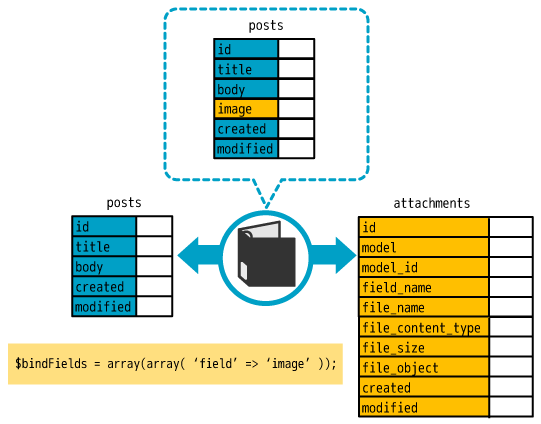
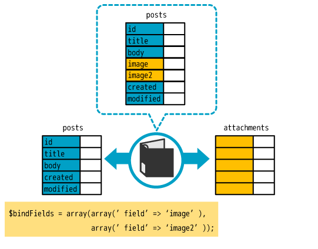
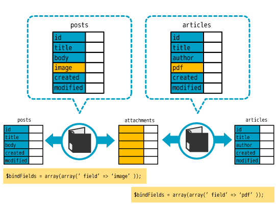
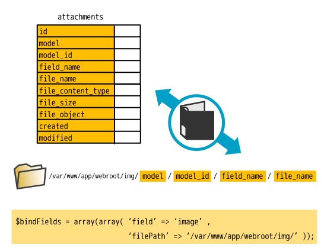

# Filebinder プラグインドキュメント

Filebinder は、CakePHP 2 のモデルのレコードにファイルを添付するプラグインです。モデルの
`$bindFields` にファイルのフィールドを書くと、`Filebinder.Bindable` ビヘイビアがアップロードされた
ファイルを保存します。ファイルの情報 (名前、コンテンツタイプ、サイズ) は添付ファイルのテーブルに、
ファイル自体はローカルのディレクトリ、データベース、Amazon S3 のいずれか (複数可) に保存します。
`find()` はレコードと一緒にファイルの情報を返し、`Filebinder.Label` ヘルパーでファイルを表示できます。

`Filebinder.Ring` コンポーネントは、確認画面のあるフォームで、リクエストをまたいでアップロードされた
ファイルを保持します。

- [インストール](#installation)
- [データベース](#database)
- [使い方](#usage)
- [ファイルのフィールド](#bound-fields)
- [ビヘイビアの設定](#behavior-settings)
- [バリデーション](#validation)
- [ファイルの削除と差し替え](#deleting-and-replacing-files)
- [Label ヘルパー](#label-helper)
- [Ring コンポーネント](#ring-component)
- [Amazon S3](#amazon-s3)
- [fusic/filebinder からの移行](#migrating-from-fusic-filebinder)
- [由来](#origin)

<a id="installation"></a>

## インストール

動作要件: PHP 8.1 以上、[pieceofcake2/cakephp](https://github.com/pieceofcake2/cakephp) 2.12 以上。
S3 に保存する場合は、[pieceofcake2/aws](https://github.com/pieceofcake2/aws) または
[pieceofcake2/async-aws](https://github.com/pieceofcake2/async-aws) も必要です
([Amazon S3](#amazon-s3) を参照)。

[Composer](https://getcomposer.org/) でプラグインをインストールします。

```bash
composer require pieceofcake2/filebinder
```

プラグインのタイプは `cakephp-plugin` なので、`composer/installers` によってプラグインディレクトリに
インストールされます。アプリケーションの `composer.json` で `installer-paths` を設定してください。

| レイアウト | `installer-paths` |
| --- | --- |
| モダン (`config/`、`src/`、`templates/`、`plugins/`) | `"plugins/{$name}/": ["type:cakephp-plugin"]` |
| レガシー (`app/Config/`、`app/Plugin/`) | `"app/Plugin/{$name}/": ["type:cakephp-plugin"]` |

`config/bootstrap.php` (レガシーレイアウトでは `app/Config/bootstrap.php`) でプラグインを読み込みます。
すでに `CakePlugin::loadAll()` を使っている場合は不要です。

```php
CakePlugin::load('Filebinder');
```

<a id="database"></a>

## データベース

添付ファイルのテーブルを作ります。ビヘイビアは `Attachment` モデル (`model` 設定) を使います。
モデルのクラスは作らなくてもかまいません。

```sql
CREATE TABLE `attachments` (
  `id` int(11) NOT NULL AUTO_INCREMENT,
  `model` text NOT NULL,
  `model_id` int(11) NOT NULL,
  `field_name` text NOT NULL,
  `file_name` text NOT NULL,
  `file_content_type` text NOT NULL,
  `file_size` int(11) NOT NULL,
  `file_object` longtext,
  `created` datetime DEFAULT NULL,
  `modified` datetime DEFAULT NULL,
  PRIMARY KEY (`id`)
) ENGINE=InnoDB DEFAULT CHARSET=utf8;
```

`file_object` には、データベースのストレージ (デフォルト) を使うときにファイルの内容を Base64 で
保存します。PostgreSQL や SQLite では、対応する型を使ってください (`file_object` は `text`)。

モデルのテーブルには、ファイルのフィールドのカラムは要りません。Filebinder はファイルのフィールドを
「仮想テーブル」として扱います。







<a id="usage"></a>

## 使い方

モデルにビヘイビアとファイルのフィールド、バリデーションルールを追加します。

```php
class Post extends AppModel
{
    public $actsAs = ['Filebinder.Bindable'];

    public $bindFields = [
        [
            'field' => 'image',
            'tmpPath' => '/var/www/html/myapp/tmp/cache/',
            'filePath' => '/var/www/html/myapp/webroot/files/',
        ],
    ];

    public $validate = [
        'title' => ['notBlank'],
        'image' => [
            'allowExtension' => [
                'rule' => ['checkExtension', ['jpg', 'jpeg', 'png']],
                'allowEmpty' => true,
            ],
            'maxFileSize' => [
                'rule' => ['checkMaxFileSize', '2MB'],
                'allowEmpty' => true,
            ],
        ],
    ];
}
```

コントローラーに Ring コンポーネントを追加し、保存の前に `bindUp()` を呼びます。`bindUp()` は
アップロードされたファイルをフィールドの `tmpPath` に移動し、アップロードのデータを、ビヘイビアが
保存するファイルの情報に置き換えます。

```php
class PostsController extends AppController
{
    public $components = ['Session', 'Filebinder.Ring'];

    public function add()
    {
        if ($this->request->is('post')) {
            $this->Ring->bindUp();
            if ($this->Post->save($this->request->data)) {
                return $this->redirect(['action' => 'index']);
            }
        }
    }
}
```

フォームには `file` タイプを指定します。

```php
echo $this->Form->create('Post', ['type' => 'file']);
echo $this->Form->input('title');
echo $this->Form->input('image', ['type' => 'file']);
echo $this->Form->end(__('Submit'));
```

`find()` はフィールドにファイルの情報を入れて返します。

```php
$this->set('post', $this->Post->findById(1));
// $post['Post']['image'] = [
//     'id' => 10,
//     'model' => 'Post',
//     'model_id' => 1,
//     'field_name' => 'image',
//     'file_name' => 'photo.jpg',
//     'file_content_type' => 'image/jpeg',
//     'file_size' => 12345,
//     'created' => '2026-10-22 10:00:00',
//     'modified' => '2026-10-22 10:00:00',
//     'file_path' => '/var/www/html/myapp/webroot/files/Post/1/image/photo.jpg',
//     'bindedModel' => 'Attachment',
// ];
```

ファイルのないレコードでは、フィールドは `null` です。ファイルは Label ヘルパーで表示します。
Label ヘルパーは Ring コンポーネントがコントローラーに追加します。

```php
echo $this->Label->image($post['Post']['image']);
```

ファイルは `<filePath>/<model>/<model_id>/<field_name>/<file_name>` に保存されます。



別の場所に保存するには、モデルで `transferTo()` をオーバーライドします。同じファイルの情報に対して
毎回同じパスを返す必要があります (乱数や時刻は使わないでください)。

```php
public function transferTo($data)
{
    return $this->alias . DS . $data['model_id'] . DS . $data['field_name'] . DS . $data['file_name'];
}
```

<a id="bound-fields"></a>

## ファイルのフィールド

`$bindFields` の各要素で、ファイルのフィールドを設定します。

| キー | デフォルト | 説明 |
| --- | --- | --- |
| `field` | | フィールド名。必須。 |
| `tmpPath` | `CACHE` | `RingComponent::bindUp()` がアップロードされたファイルを移動するディレクトリ。 |
| `filePath` | ビヘイビアの `filePath` 設定 | ファイルを保存するディレクトリ。`false` にするとローカルに保存しません。 |
| `bucket` | `Filebinder.S3.bucket` | S3 のバケット。 |
| `acl` | `Filebinder.S3.acl`、なければ `public-read` | S3 のファイルの既定 ACL。 |
| `urlPrefix` | `Filebinder.S3.urlPrefix` | S3 のファイルのキーの接頭辞 (例: `files/`)。 |
| `region` | `Filebinder.S3.region`、次にプラグインの設定 | バケットの AWS リージョン。 |

<a id="behavior-settings"></a>

## ビヘイビアの設定

```php
public $actsAs = [
    'Filebinder.Bindable' => [
        'storage' => [BindableBehavior::STORAGE_DB, BindableBehavior::STORAGE_S3],
        'filePath' => WWW_ROOT . 'files' . DS,
    ],
];
```

| 設定 | デフォルト | 説明 |
| --- | --- | --- |
| `model` | `'Attachment'` | 添付ファイルのテーブルのモデル。 |
| `filePath` | `WWW_ROOT . 'img' . DS` | `filePath` のないフィールドのファイルを保存するディレクトリ。`false` にするとローカルに保存しません。 |
| `storage` | `BindableBehavior::STORAGE_DB` | ローカルのファイルとは別に、ファイルの内容を保存する場所。`BindableBehavior::STORAGE_DB` (`'Db'`、`file_object` カラム)、`BindableBehavior::STORAGE_S3` (`'S3'`)、その両方の配列、または `false`。 |
| `restoreFromStorage` | `true` | ローカルのファイルがない (またはレコードより古い) とき、`find()` がストレージから復元します。 |
| `withObject` | `false` | `find()` が `file_object` にファイルの内容 (Base64) を入れて返します。S3 のストレージでは、データベースに内容がなければ S3 からダウンロードします。 |
| `exchangeFile` | `true` | 新しいファイルで差し替えるとき、古いファイルを削除します。`false` ではレコードだけを削除します。 |
| `beforeAttach` | `null` | アップロードされたファイルを保存する前に、そのパスを渡して呼ぶコールバック。偽の値を返すと保存を中止します。 |
| `afterAttach` | `null` | 保存した (または復元した) ローカルのファイルのパスを渡して呼ぶコールバック。偽の値を返すと `afterSave()` や `find()` の処理を止めます。 |
| `dirMode` | `0755` | 作成するディレクトリのモード。 |
| `fileMode` | `0644` | 保存、復元するファイルのモード。 |
| `dbStorage` | | 古い設定。`true` か `false` で、データベースのストレージを使うかどうかを上書きします。 |

コールバックには、関数名、モデルのメソッド名、または `[$object, 'method']` や
`['ClassName', 'method']` のような callable の配列を指定します。

実行中に `setSettings()` で設定を変更し、`getSettings()` で読み出せます。`withObject()` は
`withObject` を切り替えます。

```php
$this->Post->setSettings(['restoreFromStorage' => false]);
$this->Post->withObject(true);
```

<a id="validation"></a>

## バリデーション

ビヘイビアは、ファイルのフィールド用に次のバリデーションルールを追加します。

| ルール | 説明 |
| --- | --- |
| `['checkExtension', ['jpg', 'png']]` | ファイル名の拡張子がいずれかに一致する (大文字小文字は区別しない)。文字列も指定できます。 |
| `['checkContentType', ['image/jpeg', 'image/png']]` | ブラウザが送ったコンテンツタイプがいずれか (正規表現) に一致する。文字列も指定できます。 |
| `['checkMaxFileSize', '2MB']` | ファイルがこのサイズ以下。バイト数、または数値に `K`、`M`、`G`、`T` (と省略できる `B`) を付けた値で、大文字でも小文字でもかまいません。 |
| `['checkMinFileSize', '1KB']` | ファイルがこのサイズ以上。 |
| `['checkFileSize', '2MB']` | `checkMaxFileSize` と同じ。 |
| `['notEmptyFile']` | ファイルがアップロードされている。 |
| `['alphaNumericFileName']` | ファイル名が文字、数字、ドットだけでできている。 |
| `['funcCheckFile', 'checkIllegalCode']` | アップロードされたファイルのパスを渡すと、関数またはモデルのメソッドが true を返す。ファイルがなければ失敗します。 |

`checkContentType` が調べるのはブラウザが送ったコンテンツタイプで、ユーザーが書き換えられます。
ファイルの内容を調べるには `funcCheckFile` を使います。

```php
public $validate = [
    'image' => [
        'illegalCode' => [
            'rule' => ['funcCheckFile', 'checkIllegalCode'],
            'allowEmpty' => true,
        ],
    ],
];

public function checkIllegalCode($filePath)
{
    return !preg_match('/<\?php/i', (string)file_get_contents($filePath));
}
```

<a id="deleting-and-replacing-files"></a>

## ファイルの削除と差し替え

フィールドのファイルを削除するには、`delete_<フィールド名>` に真の値を入れて保存します。

```php
echo $this->Form->input('delete_image', ['type' => 'checkbox', 'label' => __('Delete the image')]);
```

新しいファイルを保存すると、古いファイルと差し替わります (`exchangeFile` を参照)。レコードを削除すると、
そのファイルも削除されます。`deleteEntity()` でレコードのファイルを削除することもできます。

```php
$this->Post->deleteEntity($id, 'image');
```

<a id="label-helper"></a>

## Label ヘルパー

Ring コンポーネントは、コントローラーに `Filebinder.Label` ヘルパーを追加します。Ring コンポーネントを
使わない場合は、ヘルパーを自分で追加します。

```php
public $helpers = ['Filebinder.Label'];
```

```php
echo $this->Label->image($post['Post']['image'], ['alt' => 'Photo', 'noFile' => 'No image']);
echo $this->Label->link($post['Post']['image'], ['title' => 'Download']);
echo $this->Label->url($post['Post']['image']);
```

`image()`、`link()`、`url()` は、ファイルがなければ `noFile` (なければ空文字列) を返します。

| オプション | 説明 |
| --- | --- |
| `prefix` | ファイル名の接頭辞。たとえば、ファイルの隣に保存したサムネイルの `thumb_`。 |
| `noFile` | ファイルがないときに返す値。 |
| `title` | `link()` のリンクのテキスト。デフォルトはファイル名。 |
| `S3` (または `s3`) | ローカルのファイルではなく、S3 のファイルの URL を返します (下記を参照)。 |
| `url_prefix` | `S3` と一緒に指定するキーの接頭辞。デフォルトはフィールドの `urlPrefix`、なければ `Filebinder.S3.urlPrefix`。 |

ほかのオプションは `HtmlHelper::image()`、`link()`、`url()` に渡します。

<a id="urls-of-the-files"></a>

### ファイルの URL

URL はファイルの場所で決まります。

| ファイル | URL |
| --- | --- |
| webroot の下のローカルのファイル | webroot の下のパス (例: `/files/Post/1/image/photo.jpg`)。誰でも開けます。 |
| webroot の外のローカルのファイル、確認画面でアップロードしたファイル (`tmpPath`) | プラグインの `loader` アクションの URL。セッションの秘密の値で署名され、`Filebinder.expire` で期限が切れます。 |
| S3 のファイル (`S3` オプション) で、公開の ACL (`public-read`、`public-read-write`) | [S3 クライアント](#s3-client) がリージョンやエンドポイントに合わせて作るオブジェクトの URL (例: `https://<bucket>.s3.<region>.amazonaws.com/<key>`)。 |
| S3 のファイル (`S3` オプション) で、それ以外の ACL (例: `private`) | オブジェクトの署名付き URL。`Filebinder.expire` で期限が切れます。 |

S3 のファイルのバケット、ACL、キーの接頭辞、リージョンは、モデルの `$bindFields` にあるそのフィールドの
設定か、`Filebinder.S3` の設定です。S3 のファイルには `loader` アクションも秘密の値も使いません。

S3 のファイルを非公開にするには、フィールドの `acl` (または `Filebinder.S3.acl`) を `private` にします。
ヘルパーは有効期限の短い署名付き URL を出力し、署名は S3 が確認します。ファイルはアプリケーションを
通りません。

<a id="how-the-loader-protects-the-files"></a>

### loader によるファイルの保護

`loader` アクションが確認するのは、URL の署名 (`key` パラメータ) と有効期限です。ユーザーがその
レコードを見てよいかどうかは確認しません。署名がその確認の代わりになります。どのファイルをユーザーに
見せるかは、アプリケーションがコントローラーやビューで自分の認可を行ったうえで、Label ヘルパーで URL を
出力することで決めます。URL はセッションの秘密の値と有効期限で署名されるので、アプリケーションがこの
セッションのために出力した URL だけが使えます。URL のモデル、ID、フィールド、ファイル名を変えると
404 になります。

- 認可は、リンクを出力する前に行ってください。
- 署名付きの URL は、そのセッションで、期限が切れるまで、URL を持っている人なら誰でも使えます
  (`Filebinder.expire`、デフォルトは 1 分。例: `'+10 minutes'`)。
- 秘密の値は、Ring コンポーネントか Label ヘルパーがセッションごとに作るランダムな値です。
  `Filebinder.secret` を設定すると、すべてのセッションで同じ値になり、URL は期限が切れるまでほかの
  セッションでも使えます。セッションごとの秘密の値にするには、設定しないでください。セッションに秘密の
  値がなければ、loader は 404 を返します。
- `Filebinder.S3.secret` は別の設定で、AWS のシークレットアクセスキー (非推奨) です。

<a id="ring-component"></a>

## Ring コンポーネント

```php
public $components = ['Session', 'Filebinder.Ring'];
```

| メソッド | 説明 |
| --- | --- |
| `bindUp($modelName = null, $autoBindDown = false)` | リクエストデータのアップロードされたファイルをフィールドの `tmpPath` に移動し、ファイルの情報に置き換えます。ファイルがアップロードされていなければ、`bindDown()` がセッションに保存したファイルの情報を戻します。`$autoBindDown` を指定すると、描画の前に `bindDown()` を呼びます。 |
| `bindDown($modelName = null)` | リクエストデータのファイルの情報をセッションに保存します。バリデーションエラーのあるフィールドは除きます。 |

確認画面のあるフォームでは、リクエストごとに `bindUp()` を呼びます。フォームでアップロードしたファイルは
セッションに保持され、確認画面と保存のときに戻されます。

<a id="amazon-s3"></a>

## Amazon S3

S3 のストレージは、ローカルのファイルとデータベースに加えて、Amazon S3 にファイルを保存します。

```php
public $actsAs = [
    'Filebinder.Bindable' => [
        'storage' => [BindableBehavior::STORAGE_DB, BindableBehavior::STORAGE_S3],
    ],
];

public $bindFields = [
    [
        'field' => 'image',
        'filePath' => '/var/www/html/myapp/webroot/files/',
        'bucket' => 'my-bucket',
        'acl' => 'private',
    ],
];
```

ファイルは `<urlPrefix><model>/<model_id>/<field_name>/<file_name>` というキーで保存されます。
ローカルのファイルがないと、`find()` が S3 からダウンロードします (`restoreFromStorage` を参照)。

<a id="s3-client"></a>

### S3 クライアント

S3 のストレージは、[pieceofcake2/aws](https://github.com/pieceofcake2/aws) の AWS SDK for PHP か、
[pieceofcake2/async-aws](https://github.com/pieceofcake2/async-aws) の [AsyncAws](https://async-aws.com)
を使います。どちらかをインストールして読み込みます。

```bash
composer require pieceofcake2/aws
# or
composer require pieceofcake2/async-aws async-aws/simple-s3
```

```php
CakePlugin::load('Aws');
// or
CakePlugin::load('AsyncAws');
```

読み込んだプラグインのクライアントを使います。両方読み込んだ場合は `AsyncAws` です。
`Filebinder.S3.client` で選ぶこともできます。

```php
Configure::write('Filebinder.S3.client', 'AsyncAws');
```

AWS SDK for PHP がインストールされていても、プラグインの読み込みは必要です。使えるクライアントがないと、
ファイルを保存するときに、インストールして読み込むパッケージを示す `FilebinderS3StorageException` が
発生します。

<a id="configuration"></a>

### 設定

クライアントはプラグインの設定で作られます。pieceofcake2/aws では `Aws`、pieceofcake2/async-aws では
`AsyncAws` (なければ `Aws`) です。認証情報を設定しなければ、SDK のデフォルトの認証情報 (環境変数、
共有の認証情報ファイル、EC2 インスタンスや ECS タスク、Lambda 関数の IAM ロール) を使います。

```php
Configure::write('Aws', [
    'region' => 'ap-northeast-1',
]);
Configure::write('Filebinder.S3', [
    'bucket' => 'my-bucket',
    'acl' => 'private',
    'urlPrefix' => 'files/',
]);
```

| 設定 | 説明 |
| --- | --- |
| `Filebinder.S3.client` | `'Aws'` または `'AsyncAws'`。デフォルトは読み込んだプラグインのクライアント。 |
| `Filebinder.S3.bucket` | `bucket` のないフィールドのバケット。 |
| `Filebinder.S3.acl` | `acl` のないフィールドの既定 ACL。デフォルトは `public-read`。 |
| `Filebinder.S3.urlPrefix` | `urlPrefix` のないフィールドのキーの接頭辞。 |
| `Filebinder.S3.region` | 非推奨。プラグインの設定で `region` を指定してください。`region` のないフィールドのリージョンで、プラグインの設定より優先されます。 |
| `Filebinder.S3.key`、`Filebinder.S3.secret` | 非推奨。プラグインの設定で認証情報を指定するか、デフォルトの認証情報を使ってください。アクセスキーで、プラグインの設定より優先されます。 |

AWS SDK では、ファイルの `Content-Type` は拡張子から決まります。AsyncAws では、ファイルの内容から
判定します。

<a id="s3-storage-api"></a>

### S3 ストレージの API

`s3Storage()` は、フィールドの S3 ストレージを返します。ビヘイビアと同じように設定された
`FilebinderS3StorageInterface` のインスタンスです。

```php
$storage = $this->Post->s3Storage('image');
$this->set('imageUrl', $storage->url('my-bucket', 'files/Post/1/image/photo.jpg'));
```

| メソッド | 説明 |
| --- | --- |
| `put(string $bucket, string $key, string $file, array $options = []): void` | ローカルのファイルをアップロードします。オプション: `ACL`。 |
| `get(string $bucket, string $key): string` | オブジェクトの内容を返します。 |
| `saveAs(string $bucket, string $key, string $file): void` | オブジェクトをローカルのファイルにダウンロードします。 |
| `delete(string $bucket, string $key): void` | オブジェクトを削除します。 |
| `url(string $bucket, string $key): string` | クライアントが組み立てたオブジェクトの URL (署名なし)。 |
| `presignedUrl(string $bucket, string $key, DateTimeImmutable $expires): string` | オブジェクトをダウンロードする署名付き URL。`$expires` で期限が切れます。 |

`FilebinderS3StorageFactory::create(array $args = [])` は、設定したクライアントのストレージを
クライアントのオプション (`region`、`credentials` など) で作ります。`FilebinderS3StorageFactory::client()`
はそのクライアントの名前を返します。`App::uses('FilebinderS3StorageFactory', 'Filebinder.Storage')` で
読み込みます。

<a id="migrating-from-fusic-filebinder"></a>

## fusic/filebinder からの移行

このパッケージは `fusic/filebinder` を置き換えます。プラグイン名、設定、保存されるデータ、URL は
変わりません。

1. パッケージを入れ替えます。S3 のストレージを使う場合は、S3 クライアントのプラグインもインストール
   します。

   ```bash
   composer remove fusic/filebinder
   composer require pieceofcake2/filebinder
   composer require pieceofcake2/aws
   ```

2. S3 のストレージを使う場合は、プラグインを読み込み (`CakePlugin::load('Aws')`)、認証情報と
   リージョンを `Filebinder.S3.key`、`Filebinder.S3.secret`、`Filebinder.S3.region` から `Aws` の
   設定に移すか、デフォルトの認証情報 (IAM ロールなど) を使います。古い設定も動作し、優先されますが、
   非推奨です。

動作の変更:

- S3 のストレージには、pieceofcake2/aws (または pieceofcake2/async-aws) をインストールし、
  `CakePlugin::load()` で読み込む必要があります。AWS SDK だけでは使えません。プラグインがないと、
  S3 へのファイルの保存で `FilebinderS3StorageException` が発生します。以前は、ファイルをローカルに
  保存し、アップロードせずに `afterSave()` が `false` を返していました。
- `Filebinder.S3.key` と `Filebinder.S3.secret` がなくても、プラグインの設定かデフォルトの認証情報で
  ファイルをアップロードします。以前はアップロードしませんでした。
- フィールドの `region` を、そのフィールドのすべての S3 リクエストで使います。
- アップロード中の S3 のエラーでは、SDK の元の例外が発生します。
- `funcCheckFile` は、ファイルがなければ関数を呼ばずに失敗します。
- 小文字の単位のファイルサイズ (`'1mb'`) を、その単位で解釈します。以前はキロバイトとして
  解釈していました。
- S3 から復元したファイルに `fileMode` を設定します。
- Label ヘルパーの S3 の URL (`S3` オプション) は S3 クライアントが作ります。`https` で、設定の
  リージョンやエンドポイントを使います (`http://<bucket>.s3.amazonaws.com/...` ではなく、たとえば
  `https://<bucket>.s3.<region>.amazonaws.com/...`)。`ssl` オプションは使わなくなりました。S3 クライアントの
  プラグインが必要で、バケットがなければ `null` を返します。
- Label ヘルパーの S3 の URL は、フィールドのバケット、`urlPrefix`、リージョンを使います。フィールドの ACL
  (または `Filebinder.S3.acl`) が公開でない場合 (例: `private`) は、署名付き URL になります。
- loader の URL の署名にファイル名を含めます。アップグレード前に作られた、ファイル名のある loader の
  URL (`LabelHelper` の URL はファイル名を含みます) は使えなくなります。URL の有効期限は短い
  (`Filebinder.expire`、デフォルトは 1 分) ので、その URL を表示しているページは再読み込みしてください。
- アップロードされたファイル (モデル ID `0`) について、loader は tmp ディレクトリの中のファイルだけを
  送ります。
- `Filebinder.secret` を設定しない場合、loader の URL の秘密の値はランダムになります。Ring
  コンポーネントを使わない場合は Label ヘルパーが作ります。セッションに秘密の値がなければ、loader は
  404 を返します。
- loader の `Content-Disposition` ヘッダーでは、引用符で囲んだファイル名から引用符と制御文字を除き、
  ファイル名全体を `filename*` に入れます。

修正の一覧は [CHANGELOG](https://github.com/pieceofcake2/filebinder/blob/2.x/CHANGELOG.md) を
参照してください。

<a id="origin"></a>

## 由来

このパッケージは、[株式会社 Fusic](https://fusic.co.jp) が開発した
[fusic/filebinder](https://github.com/fusic/filebinder) (2.0 ブランチ、Packagist では
`fusic/filebinder`) をフォークしたものです。モダンな PHP で動く CakePHP 2 のために
[pieceofcake2](https://github.com/pieceofcake2) がメンテナンスしています。元のプロジェクトからの変更は
[フォーク以降のコミット履歴](https://github.com/pieceofcake2/filebinder/compare/aa14aec...2.x) を
参照してください。
